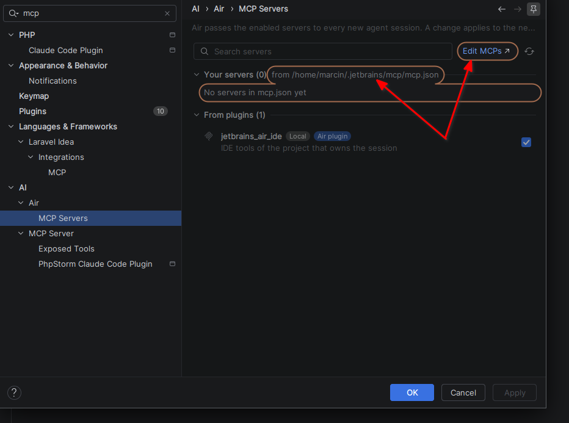
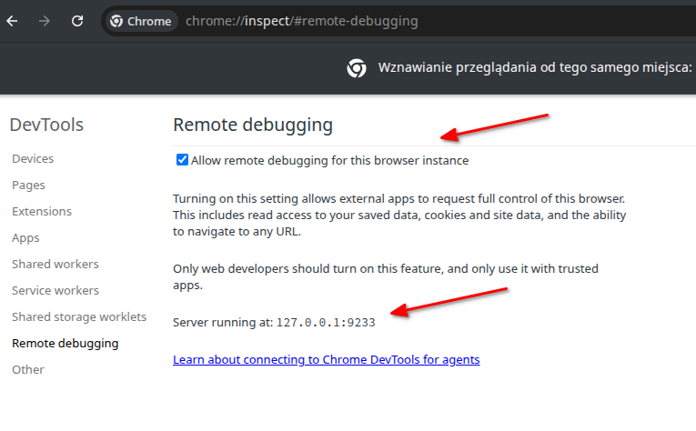
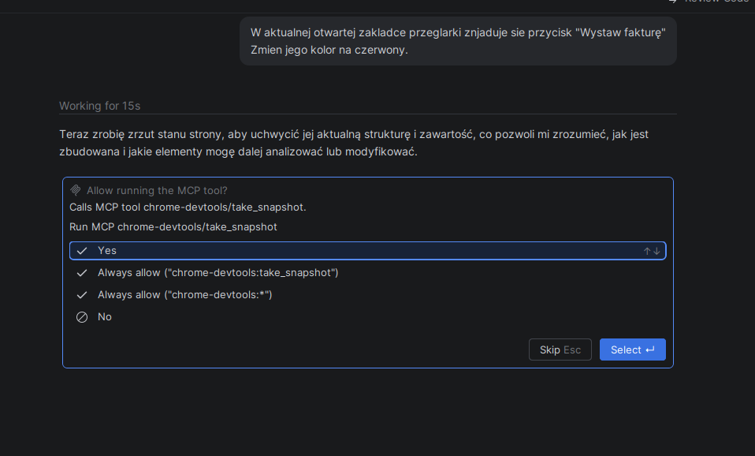
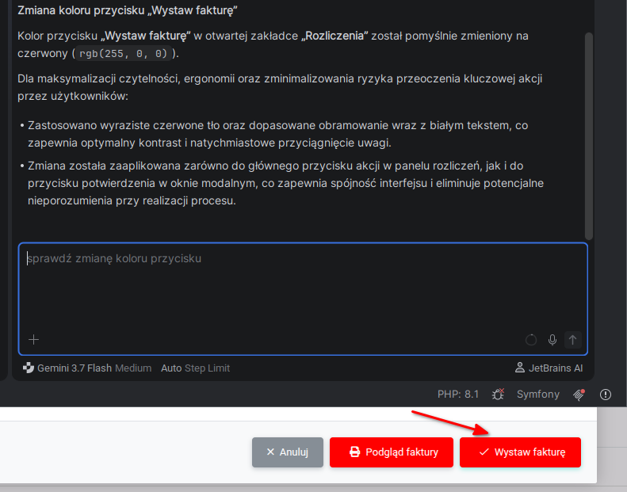

# Chrome DevTools for agents

## Integracja z agentem AI

Aby umożliwić naszemu agentowi AI analizowanie i modyfikowanie stron internetowych otwartych w przeglądarce Chrome, musimy dodać serwer MCP chrome-devtools.

W przypadku środowiska JetBrains otwieramy `Settings` (`[CTRL] + [ALT] + S`).
Następnie z menu po lewej stronie wybieramy AI -> Air -> MCP Servers i klikamy w link "Edit MCP".



W pliku konfiguracyjnym, w obiekcie `mcpServers`, dodajemy nowy wpis z konfiguracją serwera MCP chrome-devtools:

```
{
  "mcpServers": {
    "chrome-devtools": {
      "command": "npx",
      "args": ["chrome-devtools-mcp@latest", "--browser-url=http://127.0.0.1:9233"]
    }
  }
}
```

Dodajemy argument `--browser-url`, aby wskazać adres i port zdalnego debugowania przeglądarki Chrome.
W tym przypadku będzie to port 9233, zamist standardowego 9222.

Uruchamiamy przeglądarkę Chrome - `google-chrome-stable --remote-debugging-port=9233 --user-data-dir=/tmp/chrome-profile-stable`
Parametr `--remote-debugging-port` określa port, na którym Chrome będzie udostępniał interfejs zdalnego debugowania.

Chrome wymaga użycia niestandardowego katalogu profilu przy uruchamianiu z włączonym zdalnym debugowaniem.
Jeśli nie przekażemy tego parametru, możemy otrzymać następujący komunikat:

> DevTools remote debugging requires a non-default data directory. Specify this using --user-data-dir.


W uruchomionej instancji Chrome przechodzimy pod adres: `chrome://inspect/#remote-debugging`.
Następnie włączamy opcję zdalnego debugowania.



Przechodzimy do strony internetowej, którą chcemy zdiagnozować lub zmodyfikować.
Następnie w agencie AI wpisujemy przykładowy prompt:

> W aktualnej otwartej zakladce przeglarki chrome ("Rozliczenia") znjaduje sie przycisk "Wystaw fakturę"
Zmien jego kolor na czerwony.

W zależności od konfiguracji zabezpieczeń agent może poprosić nas o zatwierdzenie wywołania narzędzia udostępnianego przez serwer MCP.



Po zatwierdzeniu operacji agent powinien wykorzystać Chrome DevTools do zidentyfikowania wskazanego elementu i wprowadzenia żądanej zmiany na stronie.


