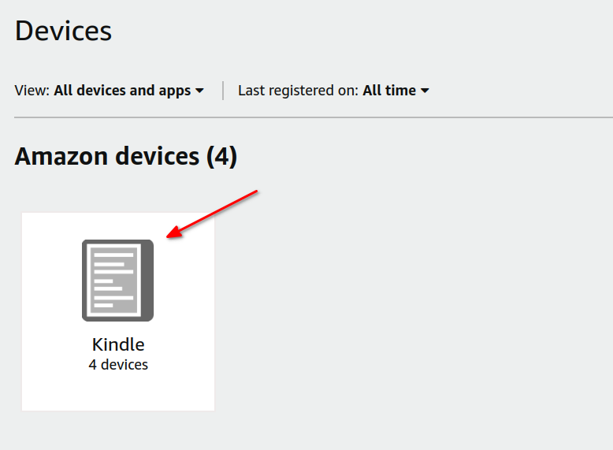
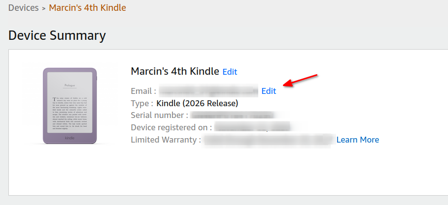

# Amazon Kindle

## Send to Kindle - zmiana adresu email

Send to Kindle to usługa umożliwiająca przesyłanie własnych dokumentów, e-booków oraz artykułów bezpośrednio na czytnik Kindle.
Po zakupie nowego urządzenia otrzymujemy nowy adres e-mail przypisany do czytnika.
Jeśli jednak chcemy nadal korzystać ze starego adresu, możemy przypisać go do nowego urządzenia, wykonując poniższe kroki.

Przechodzimy na stronę [https://www.amazon.com/myk](https://www.amazon.com/myk).

Następnie klikamy kafelek "Kindle" i wybieramy nasze urządzenie.

Na stronie edycji urządzenia klikamy link "Edit" znajdujący się obok adresu e-mail.

Postępujemy zgodnie z instrukcją.

Jeśli chcemy przypisać do nowego Kindle adres e-mail używany wcześniej na starym urządzeniu, musimy najpierw zmienić adres e-mail przypisany do starego czytnika.
Dopiero wtedy będziemy mogli przypisać zwolniony adres do nowego urządzenia.
