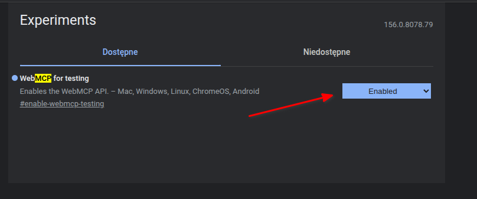
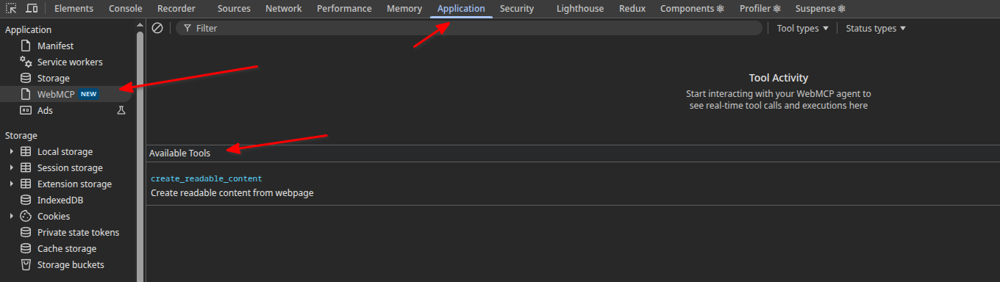
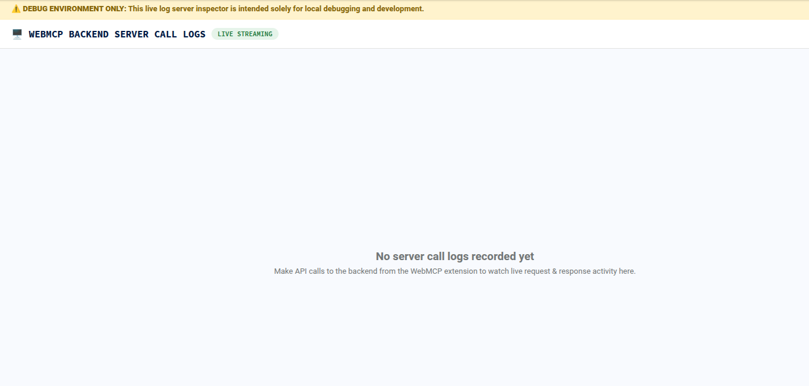
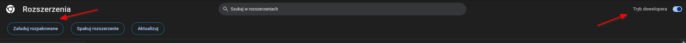
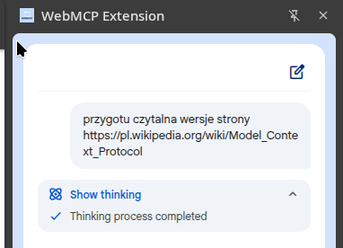

# WebMCP

Uruchamiamy przeglądarkę Chrome i przechodzimy do strony `chrome://flags`.

Wyszukujemy frazę mcp, włączamy funkcję "WebMCP for testing", a następnie ponownie uruchamiamy przeglądarkę.




Jeśli strona zarejestrowała jakieś narzędzie MCP, będzie ono widoczne w narzędziach deweloperskich.

Otwieramy narzędzia deweloperskie i przechodzimy do zakładki "Application".
Następnie w menu po lewej stronie wybieramy "WebMCP".
Zostanie wyświetlona lista dostępnych narzędzi.



## webmcp-extension

Pobieramy kod rozszerzenia - `git clone https://github.com/GoogleChromeLabs/webmcp-extension.git`

Kopiujemy przykładowy plik .env - `cp .env.example .env`

Dostosowujemy plik `.env`, wklejając token API do wybranego systemu AI oraz ustawiając odpowiednią wartość zmiennej MODEL.
Ponieważ serwer uruchomimy w kontenerze, musimy również odkomentować zmienną `HOST` i ustawić jej wartość na `0.0.0.0`.

Budujemy rozszerzenie - `docker run --rm  -v $PWD:/app -w /app --entrypoint sh  node:26 -c  'npm install && npm run build'`

Uruchamiamy serwer - `docker run -p 3000:3000 --rm  -v $PWD:/app -w /app --entrypoint sh  node:26 -c  'npm run server'`

Przechodząc na stronę `http://127.0.0.1:3000/logs` zobaczymy logi serwera.




W przeglądarce Chrome przechodzimy do strony `chrome://extensions`.
Włączamy "Tryb developera", a następnie klikamy przycisk "Załaduj rozpakowane".



W oknie wyboru katalogu przechodzimy do katalogu, w którym znajduje się pobrane rozszerzenie, a następnie wybieramy katalog `dist`

Po poprawnym załadowaniu rozszerzenia możemy korzystać z jego interfejsu:



## Przykładowe narzędzie WebMCP

```
(async () => {
    if (document.modelContext) {
        await document.modelContext.registerTool({
            name: 'create_readable_content',
            description: 'Create readable content from webpage',
            inputSchema: {
                type: 'object',
                properties: {
                    url: { type: 'string' },
                },
                required: ['url'],
            },
            execute: async ({ url }) => {
                const msg = `Create a readable content for ${url}`;
                console.log(msg);

                const input = document.querySelector('#urlInput');
                input.value = url;
                const form = document.querySelector('#processWebpageForm');
                form.submit();

                return msg;
            },
        });
    }
})()
```
